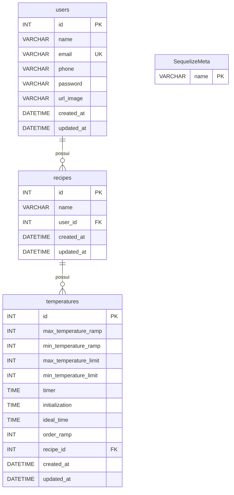

# Banco de Dados: Mash

A fonte do schema da API são as [migrations do Back-End](https://github.com/conloq/Back-End/tree/7f33203d06bd796c7840f13f1a445d082dbd7457/migrations). Em 21/10/2026, uma consulta somente de leitura confirmou que o banco local `mash` corresponde a essas migrations nos itens descritos abaixo. [Evidências e reprodução](evidencias/README.md).

## Banco atual e ambiente conferido

| Item | Observado |
|---|---|
| Servidor local | MariaDB 10.4.32, acessado pelo dialeto MySQL do Sequelize |
| Banco | `mash` |
| Tabelas de negócio | `users`, `recipes`, `temperatures` |
| Controle de migrations | `SequelizeMeta`, com três migrations registradas |
| Engine | InnoDB |
| Collation das tabelas de negócio | `utf8mb4_general_ci` |
| Collation de `SequelizeMeta` | `utf8_unicode_ci` |
| Sensibilidade a caixa | `lower_case_table_names=0` |
| Código comparado | Back-End `7f33203d06bd796c7840f13f1a445d082dbd7457` |

MariaDB é a versão observada no ambiente local. A configuração da aplicação usa o dialeto `mysql`; a implantação planejada com MySQL externo deve ser conferida separadamente. Esta evidência não comprova o banco publicado.

## Entidades e relacionamentos



- Cada receita pertence a um usuário, por `recipes.user_id`, obrigatório.
- Cada rampa pertence a uma receita, por `temperatures.recipe_id`, obrigatório.
- As duas FKs têm `ON DELETE CASCADE` e `ON UPDATE CASCADE` no banco observado.
- `SequelizeMeta` é administrativa e não tem FK com as entidades de negócio.

## Colunas físicas

JSON e atributos dos models usam camelCase; tabelas e colunas físicas usam snake_case, com `define: { underscored: true }`. Exemplos: `urlImage → url_image`, `userId → user_id`, `recipeId → recipe_id`, `orderRamp → order_ramp` e `createdAt → created_at`.

### `users`

| Coluna | Tipo observado | Aceita NULL | Chave / default |
|---|---|---|---|
| `id` | `int(11)` | Não | PK, auto incremento |
| `name` | `varchar(255)` | Não | - |
| `email` | `varchar(255)` | Não | UNIQUE |
| `phone` | `varchar(255)` | Sim | - |
| `password` | `varchar(255)` | Não | - |
| `url_image` | `varchar(255)` | Sim | - |
| `created_at` | `datetime` | Não | default current_timestamp() |
| `updated_at` | `datetime` | Não | default current_timestamp() |

### `recipes`

| Coluna | Tipo observado | Aceita NULL | Chave / default |
|---|---|---|---|
| `id` | `int(11)` | Não | PK, auto incremento |
| `name` | `varchar(255)` | Não | - |
| `user_id` | `int(11)` | Não | FK → users.id |
| `created_at` | `datetime` | Não | default current_timestamp() |
| `updated_at` | `datetime` | Não | default current_timestamp() |

### `temperatures`

| Coluna | Tipo observado | Aceita NULL | Chave / default |
|---|---|---|---|
| `id` | `int(11)` | Não | PK, auto incremento |
| `max_temperature_ramp` | `int(11)` | Não | - |
| `min_temperature_ramp` | `int(11)` | Não | - |
| `max_temperature_limit` | `int(11)` | Não | - |
| `min_temperature_limit` | `int(11)` | Não | - |
| `timer` | `time` | Não | - |
| `initialization` | `time` | Não | - |
| `ideal_time` | `time` | Não | - |
| `order_ramp` | `int(11)` | Sim | - |
| `recipe_id` | `int(11)` | Não | FK → recipes.id |
| `created_at` | `datetime` | Não | default current_timestamp() |
| `updated_at` | `datetime` | Não | default current_timestamp() |

`users.email` possui índice único. O banco não tem UNIQUE composto em `recipes(user_id, name)`; a regra de nome de receita por usuário pertence à aplicação. `updated_at` é mantido pelo Sequelize nas operações da aplicação, sem cláusula `ON UPDATE` no DDL observado.

## Como criar e evoluir o schema

No clone do Back-End, configure as variáveis `DB_*` para o ambiente desejado. Crie um banco vazio quando necessário e execute:

```bash
npm run db:migrate
npm start
```

`npm start` já executa `prestart` com as migrations. Não usar `sync()` como fonte paralela de criação. Depois de uma migration aplicada em ambiente compartilhado/publicado, mudanças de schema entram por nova migration.

Os testes de schema que criam dados ou fazem rollback devem usar banco descartável, separado do banco de trabalho. Para conferir o banco existente, use somente as consultas de metadados em `evidencias/consultas-schema.sql`.

## Implementado, planejado e simulado

- Implementado e observado: `users`, `recipes`, `temperatures` e `SequelizeMeta`.
- Planejado neste semestre: `lots`, conforme [#31](https://github.com/conloq/mash/issues/31); não existe no schema nem na main comparados nesta conferência.
- Teste de iodo: somente simulação no frontend neste semestre, com cena obrigatória no pitch. Não há tabela de análise, upload real, histórico real ou OpenCV exigidos para o depósito; ficam no backlog do próximo semestre, conforme [#66](https://github.com/conloq/mash/issues/66).
- Sensores, leituras IoT, reprocessamento e avaliações são futuros; não aparecem no MER como implementados.

## Arquivos

| Arquivo | Papel |
|---|---|
| `schema-api.sql` | DDL de referência obtido de SHOW CREATE TABLE do banco local; sem dados e sem DROP; não substitui migrations nem deve ser importado no banco de trabalho |
| `diagrama_mer_mash.mmd` | Fonte Mermaid do schema atual, também renderizada neste README |
| `evidencias/` | Metadados, resultado da comparação e consultas de leitura para reprodução |
| `mash.sql` | Script histórico do app legado `cervejaria`; contém DROP e não corresponde à API atual |
| `legacy/README.md` | Documentação anterior, preservada como histórico |

O SQL legado fica preservado para rastreabilidade. Não executar `mash.sql` para criar ou atualizar o banco da API. Não há dados de usuários ou credenciais nos arquivos de evidência.
