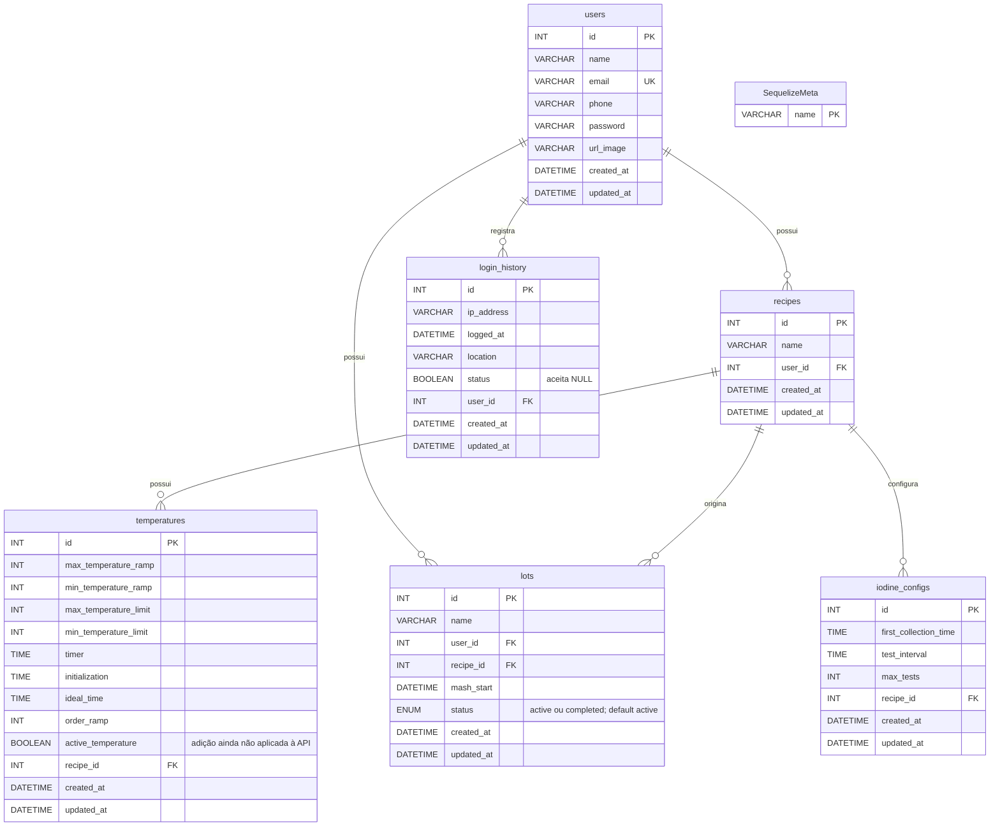

# Banco de Dados: Mash

A fonte do schema da API são as [migrations do Back-End](https://github.com/conloq/Back-End/tree/7f33203d06bd796c7840f13f1a445d082dbd7457/migrations). Em 21/10/2026, uma consulta somente de leitura confirmou que o banco local `mash` corresponde a essas migrations nos itens descritos abaixo. [Evidências e reprodução](evidencias/README.md).

## Banco atual e ambiente conferido

| Item | Observado |
|---|---|
| Servidor local | MariaDB 10.4.32, acessado pelo dialeto MySQL do Sequelize |
| Banco | `mash` |
| Tabelas de negócio | `users`, `recipes`, `temperatures` |
| Controle de migrations | `SequelizeMeta`, com três migrations registradas |
| Engine | InnoDB |
| Collation das tabelas de negócio | `utf8mb4_general_ci` |
| Collation de `SequelizeMeta` | `utf8_unicode_ci` |
| Sensibilidade a caixa | `lower_case_table_names=0` |
| Código comparado | Back-End `7f33203d06bd796c7840f13f1a445d082dbd7457` |

MariaDB é a versão observada no ambiente local. A configuração da aplicação usa o dialeto `mysql`; a implantação planejada com MySQL externo deve ser conferida separadamente. Esta evidência não comprova o banco publicado.

## Entidades e relacionamentos do modelo atualizado

O modelo de referência reúne `users`, `recipes`, `temperatures`, `lots`, `iodine_configs` e `login_history`, além de `SequelizeMeta`. As três últimas tabelas de negócio e `temperatures.active_temperature` são as adições do `schema-complementar.sql`, ainda não aplicadas à API. A tabela de ambiente acima e as evidências descrevem somente o banco observado antes dessas adições.



- Cada receita pertence a um usuário, por `recipes.user_id`, obrigatório.
- Cada rampa pertence a uma receita, por `temperatures.recipe_id`, obrigatório.
- As duas FKs têm `ON DELETE CASCADE` e `ON UPDATE CASCADE` no banco observado.
- No complemento, cada lote pertence a um usuário e a uma receita; configurações de iodo pertencem a receitas e registros de login pertencem a usuários.
- `SequelizeMeta` é administrativa e não tem FK com as entidades de negócio.

## Colunas físicas do modelo atualizado

As tabelas originais abaixo mostram os tipos observados; adições do complemento estão identificadas separadamente.

JSON e atributos dos models usam camelCase; tabelas e colunas físicas usam snake_case, com `define: { underscored: true }`. Exemplos: `urlImage → url_image`, `userId → user_id`, `recipeId → recipe_id`, `orderRamp → order_ramp` e `createdAt → created_at`.

### `users`

| Coluna | Tipo observado | Aceita NULL | Chave / default |
|---|---|---|---|
| `id` | `int(11)` | Não | PK, auto incremento |
| `name` | `varchar(255)` | Não | - |
| `email` | `varchar(255)` | Não | UNIQUE |
| `phone` | `varchar(255)` | Sim | - |
| `password` | `varchar(255)` | Não | - |
| `url_image` | `varchar(255)` | Sim | - |
| `created_at` | `datetime` | Não | default current_timestamp() |
| `updated_at` | `datetime` | Não | default current_timestamp() |

### `recipes`

| Coluna | Tipo observado | Aceita NULL | Chave / default |
|---|---|---|---|
| `id` | `int(11)` | Não | PK, auto incremento |
| `name` | `varchar(255)` | Não | - |
| `user_id` | `int(11)` | Não | FK → users.id |
| `created_at` | `datetime` | Não | default current_timestamp() |
| `updated_at` | `datetime` | Não | default current_timestamp() |

### `temperatures`

| Coluna | Tipo observado | Aceita NULL | Chave / default |
|---|---|---|---|
| `id` | `int(11)` | Não | PK, auto incremento |
| `max_temperature_ramp` | `int(11)` | Não | - |
| `min_temperature_ramp` | `int(11)` | Não | - |
| `max_temperature_limit` | `int(11)` | Não | - |
| `min_temperature_limit` | `int(11)` | Não | - |
| `timer` | `time` | Não | - |
| `initialization` | `time` | Não | - |
| `ideal_time` | `time` | Não | - |
| `order_ramp` | `int(11)` | Sim | - |
| `active_temperature` | `boolean` | Não | Adição do complemento, ainda não aplicada; default FALSE |
| `recipe_id` | `int(11)` | Não | FK → recipes.id |
| `created_at` | `datetime` | Não | default current_timestamp() |
| `updated_at` | `datetime` | Não | default current_timestamp() |

`users.email` possui índice único. O banco não tem UNIQUE composto em `recipes(user_id, name)`; a regra de nome de receita por usuário pertence à aplicação. `updated_at` é mantido pelo Sequelize nas operações da aplicação, sem cláusula `ON UPDATE` no DDL observado.

### `lots` (complemento, ainda não aplicado)

| Coluna | Tipo de referência | Aceita NULL | Chave / default |
|---|---|---|---|
| `id` | `int` | Não | PK, auto incremento |
| `name` | `varchar(255)` | Não | - |
| `user_id` | `int` | Não | FK → users.id |
| `recipe_id` | `int` | Não | FK → recipes.id |
| `mash_start` | `datetime` | Não | default CURRENT_TIMESTAMP |
| `status` | `enum('active', 'completed')` | Não | default active |
| `created_at` | `datetime` | Não | default CURRENT_TIMESTAMP |
| `updated_at` | `datetime` | Não | default CURRENT_TIMESTAMP |

### `iodine_configs` (complemento, ainda não aplicado)

| Coluna | Tipo de referência | Aceita NULL | Chave / default |
|---|---|---|---|
| `id` | `int` | Não | PK, auto incremento |
| `first_collection_time` | `time` | Não | - |
| `test_interval` | `time` | Não | - |
| `max_tests` | `int` | Não | - |
| `recipe_id` | `int` | Não | FK → recipes.id |
| `created_at` | `datetime` | Não | default CURRENT_TIMESTAMP |
| `updated_at` | `datetime` | Não | default CURRENT_TIMESTAMP |

### `login_history` (complemento, ainda não aplicado)

| Coluna | Tipo de referência | Aceita NULL | Chave / default |
|---|---|---|---|
| `id` | `int` | Não | PK, auto incremento |
| `ip_address` | `varchar(255)` | Não | - |
| `logged_at` | `datetime` | Não | default CURRENT_TIMESTAMP |
| `location` | `varchar(255)` | Não | - |
| `status` | `boolean` | Sim | - |
| `user_id` | `int` | Não | FK → users.id |
| `created_at` | `datetime` | Não | default CURRENT_TIMESTAMP |
| `updated_at` | `datetime` | Não | default CURRENT_TIMESTAMP |

## Como criar e evoluir o schema

No clone do Back-End, configure as variáveis `DB_*` para o ambiente desejado. Crie um banco vazio quando necessário e execute:

```bash
npm run db:migrate
npm start
```

`npm start` já executa `prestart` com as migrations. Não usar `sync()` como fonte paralela de criação. Depois de uma migration aplicada em ambiente compartilhado/publicado, mudanças de schema entram por nova migration.

Os testes de schema que criam dados ou fazem rollback devem usar banco descartável, separado do banco de trabalho. Para conferir o banco existente, use somente as consultas de metadados em `evidencias/consultas-schema.sql`.

## Implementado, planejado e simulado

- Implementado e observado: `users`, `recipes`, `temperatures` e `SequelizeMeta`.
- Planejado neste semestre: `lots`, conforme [#31](https://github.com/conloq/mash/issues/31); não existe no schema nem na main comparados nesta conferência.
- Teste de iodo: somente simulação no frontend neste semestre, com cena obrigatória no pitch. Não há tabela de análise, upload real, histórico real ou OpenCV exigidos para o depósito; ficam no backlog do próximo semestre, conforme [#66](https://github.com/conloq/mash/issues/66).
- Sensores, leituras IoT, reprocessamento e avaliações são futuros; não aparecem no MER como implementados.

## Complemento de schema solicitado em 21/10/2026

Por solicitação do Haimon, somente neste repositório, o [SQL complementar](schema-complementar.sql) acrescenta as estruturas abaixo à base descrita em `schema-api.sql`. São definições de referência: não foram aplicadas ao banco de trabalho nem implementadas nos models ou migrations do Back-End. As evidências anteriores continuam descrevendo apenas o schema observado. O [diagrama complementar](diagrama_mer_complementar.mmd) mostra as adições e seus vínculos, abreviando as entidades existentes.

| Adição | Origem e campos |
|---|---|
| `temperatures.active_temperature` | Equivalente de `temperaturas.temperatura_ativa`: BOOLEAN obrigatório, default FALSE; preserva `order_ramp`. Não impõe unicidade de rampa ativa por receita, assim como o legado |
| `lots` | Contrato da [#31](https://github.com/conloq/mash/issues/31): `id`, `name`, `user_id`, `recipe_id`, `mash_start`, `status`, `created_at`, `updated_at`; status `active`/`completed`, default `active` |
| `iodine_configs` | Equivalente de `iodos`: `tempo_primeira_coleta → first_collection_time`, `intervalo_testes → test_interval`, `qtd_max_testes → max_tests`, `receita_id → recipe_id`, além de id e timestamps |
| `login_history` | Equivalente de `Historico_Logins`: `endereco_ip → ip_address`, `data_hora → logged_at`, `localidade → location`, `status`, `usuario_id → user_id`, além de id e timestamps; status continua anulável |

As colunas novas seguem inglês e snake_case. As tabelas novas usam InnoDB e `utf8mb4_general_ci`. O SQL preserva a exclusão em cascata dos vínculos legados de configuração e histórico; para lotes, usa RESTRICT na exclusão de usuário/receita para preservar os registros. O vínculo entre lote e receita do mesmo usuário precisa de validação na futura API. Os timestamps seguem o padrão atual: default de cadastro; atualização de `updated_at` pela aplicação, sem `ON UPDATE` automático.

Para validar o DDL, usar banco vazio descartável: primeiro `schema-api.sql`, depois `schema-complementar.sql`, uma única vez. O complemento não tem DROP, não copia dados legados e não deve ser aplicado manualmente ao banco da API. A adoção pela aplicação exige novas migrations e alinhamento dos models, em trabalho separado.

Adicionar a referência de `iodine_configs` não antecipa o fluxo real de iodo: neste semestre continua somente a simulação frontend e sua cena obrigatória no pitch. Imagens, resultados de análise, OpenCV e demais funcionalidades futuras não foram acrescentados a este complemento.

## Arquivos

| Arquivo | Papel |
|---|---|
| `schema-api.sql` | DDL de referência obtido de SHOW CREATE TABLE do banco local; sem dados e sem DROP; não substitui migrations nem deve ser importado no banco de trabalho |
| `diagrama_mer_mash.mmd` | Modelo atualizado completo, com adições ainda não aplicadas à API; renderizado neste README |
| `schema-complementar.sql` | Adições solicitadas: active_temperature, lotes, configuração de iodo e histórico de login; referência ainda não aplicada à API |
| `diagrama_mer_complementar.mmd` | Adições e relacionamentos do complemento; entidades existentes abreviadas |
| `evidencias/` | Metadados, resultado da comparação e consultas de leitura para reprodução |
| `mash.sql` | Script histórico do app legado `cervejaria`; contém DROP e não corresponde à API atual |
| `legacy/README.md` | Documentação anterior, preservada como histórico |

O SQL legado fica preservado para rastreabilidade. Não executar `mash.sql` para criar ou atualizar o banco da API. Não há dados de usuários ou credenciais nos arquivos de evidência.
